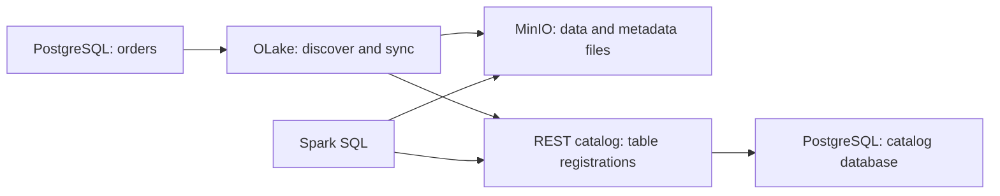

# PostgreSQL to Apache Iceberg with OLake

This tutorial walks through using OLake to discover a PostgreSQL table, copy its data into Apache Iceberg through a REST catalog, and query the result with Spark SQL.

You will create 15 sample orders and verify that Spark returns the same business data as PostgreSQL. The setup runs locally in Docker and uses **full refresh**: the destination is populated when you execute the sync.

## How the pipeline works



OLake connects to PostgreSQL, discovers the table's columns and types, and writes the selected rows into an Iceberg table. MinIO stores its Parquet data files and Iceberg metadata. The REST catalog tracks the table's current metadata location, allowing Spark to find and query the analytical copy.

The same PostgreSQL container holds two separate databases: `orders_demo` for source orders and `iceberg_catalog` for the REST catalog's registrations. Spark reads the destination files from MinIO.

## Prerequisites

- Git.
- Docker Desktop running with Linux containers and Docker Compose.
- PowerShell for the commands below.
- Internet access and disk space for the container images.
- Available host ports `5432` (PostgreSQL), `9001` (MinIO console), and `8181` (REST catalog).

This guide starts from a fresh clone and new demo volumes. Run all commands from the repository directory. PowerShell backticks continue a command onto the next line.

## 1. Clone the repository and configure credentials

```powershell
git clone https://github.com/SohumDamani/olake-postgres-iceberg-demo.git
cd olake-postgres-iceberg-demo
docker version
docker compose version
Copy-Item .env.example .env
```

Docker should display both **Client** and **Server** sections. If the Server section is unavailable, start Docker Desktop and wait for the engine to become ready.

Open `.env` and replace the two password placeholders with different local passwords. Keep the database and username defaults so they match the commands in this guide. If host port `5432` is occupied, change `POSTGRES_PORT` to `5433`; containers will still connect to PostgreSQL on its internal port `5432`.

**Expected outcome:** Docker is reachable and `.env` contains the local credentials. This file is ignored by Git; only the placeholder template is committed.

## 2. Start PostgreSQL and inspect the source table

```powershell
docker compose config --quiet
docker compose up -d --wait postgres
docker compose exec -T postgres psql -U olake_demo -d orders_demo `
  -c "SELECT id, customer_name, amount_cents, status FROM public.orders ORDER BY id;"
```

Compose starts PostgreSQL and waits until it accepts connections. The `POSTGRES_DB=orders_demo` setting creates the source database automatically. During first initialization, [the seed SQL](sql/01-seed-orders.sql) creates `public.orders` and inserts 15 rows.

The query should return IDs 1 through 15 with four business columns: `id`, `customer_name`, `amount_cents`, and `status`. Amounts are integer cents, avoiding floating-point rounding during comparison.

Check the source totals:

```powershell
docker compose exec -T postgres psql -U olake_demo -d orders_demo `
  -c "SELECT COUNT(*) AS row_count, SUM(amount_cents) AS total_cents FROM public.orders;"
```

```text
 row_count | total_cents
-----------+-------------
        15 |      120000
```

**Expected outcome:** PostgreSQL contains 15 orders totaling 120000 cents. This is the source data OLake will copy.

## 3. Create the catalog database and start the destination services

The REST catalog needs a database to store table registrations, including the location of each table's current Iceberg metadata. PostgreSQL created only `orders_demo` in step 2. Create the additional database required by the catalog:

```powershell
docker compose exec -T postgres psql -U olake_demo -d orders_demo `
  -c "CREATE DATABASE iceberg_catalog;"
```

The command should print `CREATE DATABASE`. It connects through the existing source database to issue the SQL command; the new `iceberg_catalog` database is separate from the source orders.

Start MinIO, the bucket initializer, the REST catalog, and Spark:

```powershell
docker compose pull minio create-bucket rest spark
docker compose up -d minio create-bucket rest spark
docker compose ps --all
Invoke-RestMethod http://localhost:8181/v1/config
```

The image download can take several minutes, especially for Spark. Once started:

- **MinIO** stores objects in a persistent volume.
- **create-bucket** creates the `warehouse` bucket and exits.
- **rest** connects to `iceberg_catalog` and serves the catalog API.
- **spark** stays available so you can launch a SQL session.

**Expected outcome:** PostgreSQL, MinIO, REST, and Spark are running. `create-bucket` shows **Exited (0)**, which means its one-time task succeeded. The REST endpoint returns a response containing `defaults` and `overrides`; if it is still starting, retry that check after a few seconds.

You can open the [MinIO console](http://localhost:9001) and sign in with `MINIO_ROOT_USER` and `MINIO_ROOT_PASSWORD` from `.env`. The `warehouse` bucket should exist, but it will not contain the orders table until OLake syncs it.

## 4. Configure OLake's source and destination

Create local configuration files from the committed templates:

```powershell
New-Item -ItemType Directory -Path runtime -Force | Out-Null
Copy-Item config/source.example.json runtime/source.json
Copy-Item config/destination.example.json runtime/destination.json
```

Edit the copies and replace their placeholders:

| Local JSON field | Value from `.env` |
| --- | --- |
| `source.json`: `password` | `POSTGRES_PASSWORD` |
| `destination.json`: `writer.aws_access_key` | `MINIO_ROOT_USER` |
| `destination.json`: `writer.aws_secret_key` | `MINIO_ROOT_PASSWORD` |

The source file tells OLake to connect to `orders_demo` at `postgres:5432` and discover the `public` schema. The destination file points to the REST catalog at `http://rest:8181` and the `warehouse` bucket through `http://minio:9000`.

The `aws_*` names are OLake's S3-client settings for **local MinIO**. They use your MinIO credentials and a fixed signing region; no AWS account is required.

**Expected outcome:** both local JSON files contain credentials matching `.env`. The `runtime/` directory is ignored by Git.

## 5. Check the connection and discover the schema

```powershell
docker compose pull olake
docker compose run --rm olake check --config /mnt/config/source.json
```

The check should report:

```json
{"connectionStatus":{"status":"SUCCEEDED"},"type":"CONNECTION_STATUS"}
```

Now ask OLake to discover the source:

```powershell
docker compose run --rm olake discover --config /mnt/config/source.json
```

Discovery generates `runtime/streams.json`. Open it to see `orders` in namespace `public`, its columns and types, and primary key `id`. OLake also adds metadata columns such as `_olake_id`, `_olake_timestamp`, and `_op_type`.

**Expected outcome:** OLake has connected successfully and described the source table. Discovery has not yet copied any orders into Iceberg.

## 6. Select full refresh and sync the orders

In `runtime/streams.json`, confirm that `selected_streams.public` contains only the `orders` selection. In the corresponding `streams` entry, set `sync_mode` to `full_refresh` and remove `cursor_field`:

```diff
- "cursor_field": "amount_cents",
- "sync_mode": "incremental",
+ "sync_mode": "full_refresh",
```

Keep the other schema and destination fields intact. This mode copies the complete table and does not require a cursor to track changes.

Run OLake:

```powershell
docker compose run --rm olake sync `
  --config /mnt/config/source.json `
  --streams /mnt/config/streams.json `
  --destination /mnt/config/destination.json
```

OLake uses `source.json` to read PostgreSQL, `streams.json` to select the table and mode, and `destination.json` to write Iceberg files and register the table through the REST catalog.

**Expected outcome:** the sync completes successfully and reports 15 records read. The destination table is `postgres_orders_demo_public.orders`. MinIO now contains its data and metadata files.

Full refresh clears and reloads the selected destination table. The source PostgreSQL orders remain unchanged. Continuous change capture is not configured.

## 7. Query the Iceberg table and compare the results

Launch Spark SQL with the REST catalog and MinIO connection settings:

```powershell
docker compose exec spark spark-sql `
  --master "local[2]" `
  --conf spark.sql.catalog.demo=org.apache.iceberg.spark.SparkCatalog `
  --conf spark.sql.catalog.demo.type=rest `
  --conf spark.sql.catalog.demo.uri=http://rest:8181 `
  --conf spark.sql.catalog.demo.io-impl=org.apache.iceberg.aws.s3.S3FileIO `
  --conf spark.sql.catalog.demo.s3.endpoint=http://minio:9000 `
  --conf spark.sql.catalog.demo.s3.path-style-access=true
```

At the `spark-sql>` prompt, run:

```sql
SET spark.sql.cli.print.header=true;
SHOW NAMESPACES IN demo;
SHOW TABLES IN demo.postgres_orders_demo_public;

SELECT id, customer_name, amount_cents, status
FROM demo.postgres_orders_demo_public.orders
ORDER BY id;

SELECT COUNT(*) AS row_count, SUM(amount_cents) AS total_cents
FROM demo.postgres_orders_demo_public.orders;
```

`demo` is Spark's catalog label. Spark asks the REST catalog for the table metadata, reads the Iceberg files from MinIO, and executes these queries.

**Expected outcome:** the table listing includes `orders`; the row query returns the same 15 business rows as PostgreSQL in step 2; the aggregate query returns:

```text
row_count  total_cents
15         120000
```

Compare every sorted business row as well as the totals. Matching counts and sums alone do not prove identical data. Exclude OLake's metadata columns from the comparison. Exit Spark SQL with `quit;`.

### Spark result screenshots

Screenshots of the row query and aggregate results will be added here.

## Gotchas and things to keep in mind

- **Discovery can select incremental mode.** Explicitly select `full_refresh` for this tutorial. `amount_cents` is not a reliable change-tracking cursor.
- **PostgreSQL initialization runs only on an empty volume.** The source database and seed table are created at first startup; the catalog database is created explicitly in step 3.
- **Persist catalog registrations and objects.** The PostgreSQL volume stores both databases; the MinIO volume stores the Iceberg files. Both are needed to retain the destination.
- **Use service names inside Docker.** `localhost` refers to the current container. Connections between services use `postgres`, `rest`, and `minio`.
- **The destination namespace differs from the source schema.** Query `demo.postgres_orders_demo_public.orders`, not `demo.public.orders`.
- **Some startup messages are expected.** The bucket initializer may retry while MinIO starts. Full refresh may report a missing destination before creating it. OLake may also create a separate `test_olake` connection-test table.
- **Redact REST startup logs before sharing.** The catalog image prints its JDBC password.

## Stop the demo

```powershell
docker compose down
```

This stops the containers while preserving the PostgreSQL and MinIO volumes.

## References

- [OLake Docker CLI](https://olake.io/docs/install/docker-cli/)
- [PostgreSQL connector](https://olake.io/docs/connectors/postgres/)
- [REST catalog configuration](https://olake.io/docs/writers/iceberg/catalog/rest/)
- [Iceberg Spark quickstart](https://iceberg.apache.org/spark-quickstart/)
